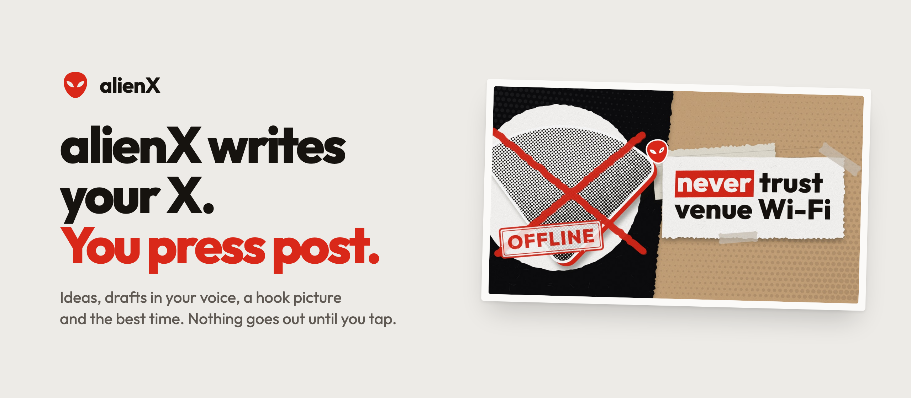
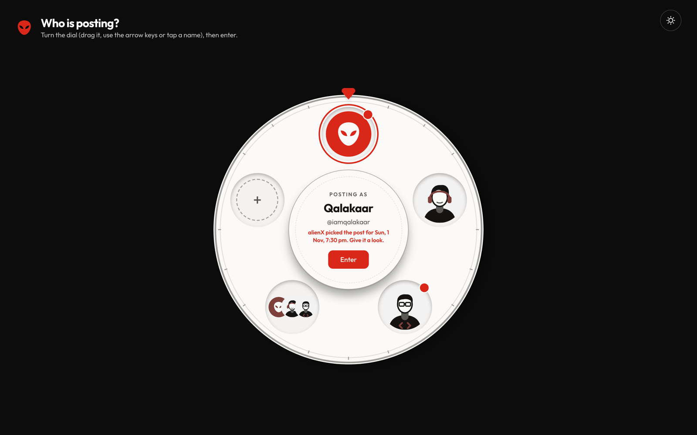
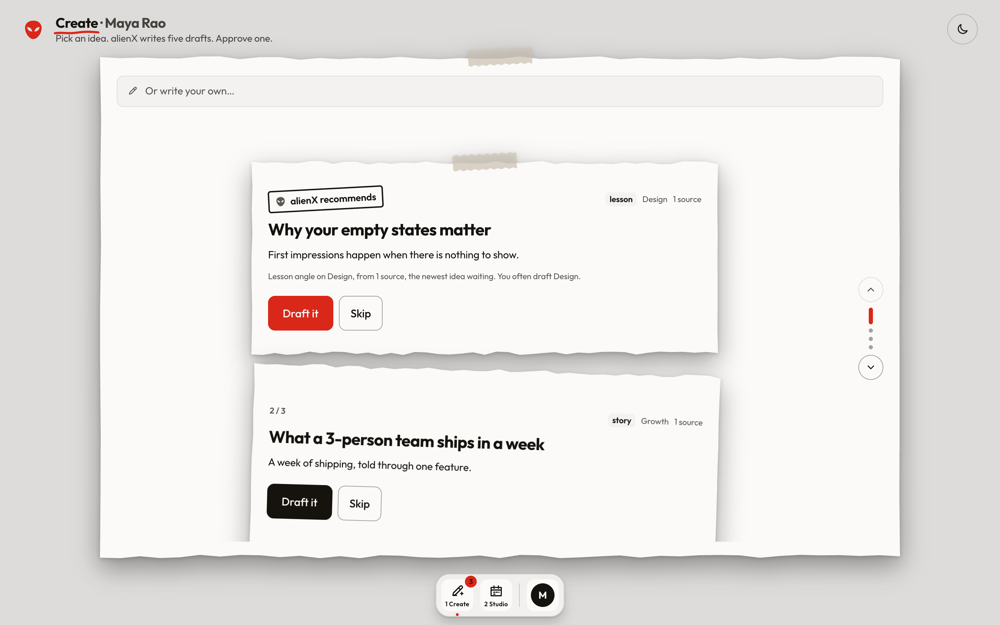
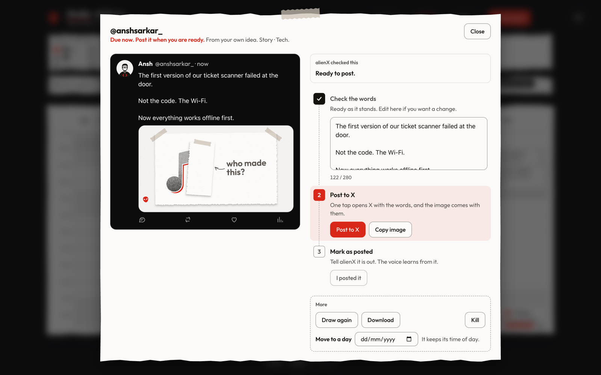
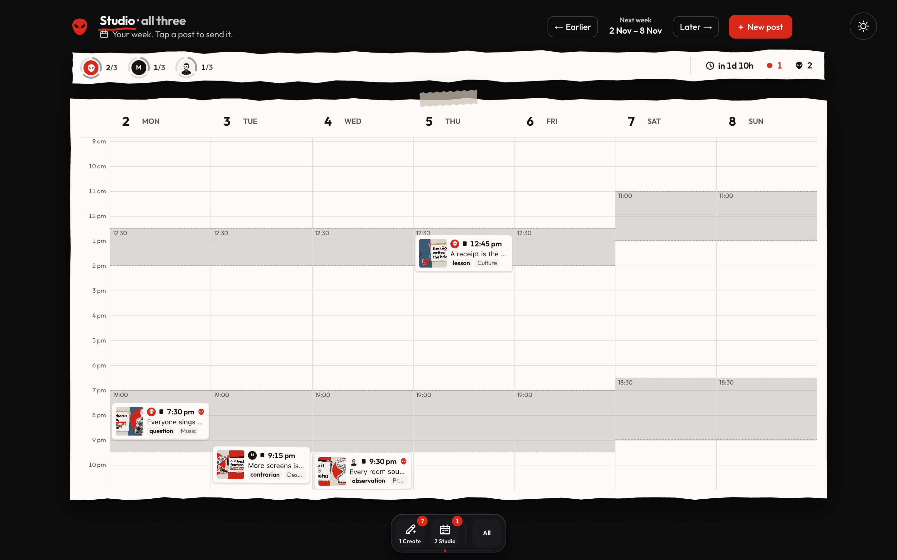
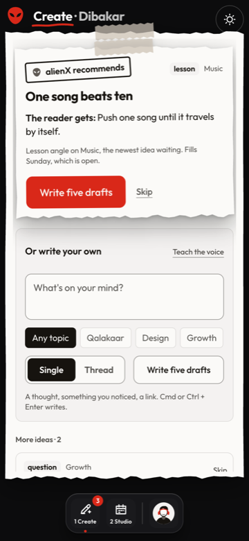
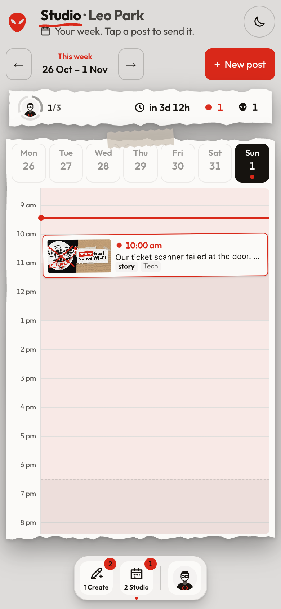
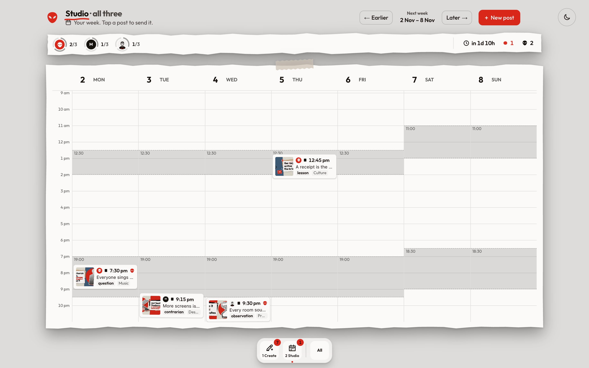

# alienX

**alienX writes your X. You press post.** It finds ideas worth saying, writes five drafts in your own voice, draws a picture for each post and books the best time. Nothing goes out until you tap. It runs on your Mac or Windows PC, free with your Claude plan.



## Download for Mac or Windows

**[dibakar01.github.io/alienx](https://dibakar01.github.io/alienx/)**: one tap downloads alienX, [for Mac](docs/download/alienX.zip) or [for Windows](docs/download/alienX-windows.zip). Open the zip and double-click **alienX** (on Windows, **Install alienX**). It installs itself and opens in your browser.

- **Mac** needs [Node 24+](https://nodejs.org), [Google Chrome](https://www.google.com/chrome) and the [Claude Code CLI](https://claude.com/claude-code) signed in with your Claude plan. First open only: System Settings → Privacy & Security → Open Anyway.
- **Windows** needs [Node 24+](https://nodejs.org), [Git](https://git-scm.com), the [Claude Code CLI](https://claude.com/claude-code) signed in, and Chrome or Edge. First open only: Windows asks once — More info → Run anyway.

You can also install from Terminal on a Mac:

```bash
curl -fsSL https://raw.githubusercontent.com/Dibakar01/alienx/main/install.sh | bash
```

or from PowerShell on Windows (it installs into `%USERPROFILE%\alienX`):

```powershell
irm https://raw.githubusercontent.com/Dibakar01/alienx/main/install.ps1 | iex
```

## Make your account

The first screen makes your account in three steps:

1. **Your X account:** your handle and name. alienX never logs into X; you post yourself.
2. **What you post about:** tap topics, or type your own.
3. **How you sound:** tap a few style words (Witty, Plainspoken, Story-led…).

Add a blog or past posts under "Teach it more" and alienX learns your real voice from them. Add facts about you or your company, and alienX states nothing beyond them.

| | |
|---|---|
|  |  |
| **Pick who is posting.** One tap on the dial. | **Create.** Scroll through ideas, one at a time; Draft it or Skip. |
|  |  |
| **Post.** alienX checks it, then one tap opens X. | **Light and dark.** Follows your computer. |

<p align="center"> </p>

**Every post gets a hook picture**, a collage with a punchline:

| | |
|---|---|
|  |  |

*Screenshots use made-up demo accounts and posts.*

## How it works



- **Ideas.** alienX searches the last two weeks of your world and brings a deck of ideas, each with why now. New ones arrive on their own.
- **Drafts.** Five drafts per idea, one per angle (story, contrarian, observation, lesson, question), written the way X ranks posts: a hook first line, short lines, one concrete detail, no link (the source goes in a ready first reply). Every claim is tagged with where it came from.
- **Pictures.** Each post gets a collage picture in alienX's scrapbook style, drawn by code from the model's idea.
- **Calendar.** Posts land in your best slot, at most one a day, three a week. The default is in `config/slots.json`; give one account its own windows in the git-ignored `config/local.json`, under `"slots"` keyed by handle. At its time a post turns due and your computer tells you.
- **Time zone.** Times follow the `"zone"` in `config/slots.json` (India time by default). Put a `"zone"` under `"slots"` in `config/local.json` to book posts in another zone; the pages still show India time.
- **alienX manages.** Once a day it books one post for an account with nothing coming, marked as alienX's pick until you keep it.
- **It learns your taste.** What you draft and what you skip shapes the next ideas and which one alienX recommends first.

Your accounts, voices, facts and posts stay on your computer.

## Run from the source

```bash
npm run setup      # once: checks Node, the browser and Claude, installs packages
npm run dev        # http://127.0.0.1:3000 with live reload
npm test
```

`npm run setup`, `npm run open` and `npm run stop` work on Mac and Windows.

`scripts/agents.sh` (on Windows, `scripts/agents.ps1`) keeps alienX running in the background (the server, the minute clock, Sunday ideas, the daily pick); add `remove` to take it out again.

Backups: a copy of the database is kept for the last 7 days in `data/backups`; to restore, stop alienX and copy one over `data/alienx.db`.

## Credits

- Made by [Qalakaar](https://qalakaar.com). The look is One Flow, Qalakaar's scrapbook design system.
- [Phosphor Icons](https://phosphoricons.com) (MIT); see `brand/icons/LICENSE-phosphor.txt`.
- [Outfit](https://fonts.google.com/specimen/Outfit) (SIL OFL 1.1); see `brand/fonts/OFL.txt`.
- [React Bits](https://reactbits.dev) (MIT): the Dock, adapted in `app/bits/`.
