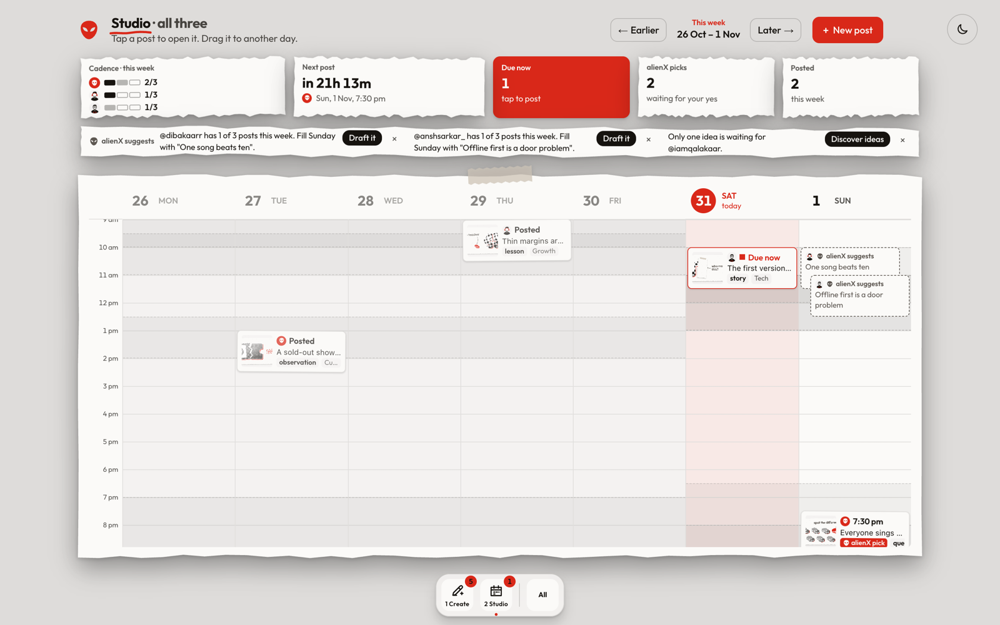

# alienX

alienX runs a small team's X presence with the founders as editors. Each week it researches what each account should say, drafts posts in that account's own voice, draws one picture-led image per post, and schedules every post into the account's best slot. A founder can edit, move or kill any post until its slot comes up. At the slot the post is due, and it goes out only when a founder taps **Post to X**. alienX never posts by itself.

It is built for [Qalakaar](https://qalakaar.com) and its three accounts, and it runs on one Mac at no cost: model calls go through the Claude Code CLI on a Claude subscription, never a paid API.


| | |
|---|---|
|  |  |
| **Who is posting.** Turn the dial; a red dot marks an account that needs you. | **Create.** One tap on an idea writes five drafts; approve one and it is on the calendar. |
|  |  |
| **Posting.** alienX checks it, then the steps run in order: check the words, post to X, mark as posted. | **Light and dark.** Follows your system; one switch overrides it. |

<p align="center"> </p>

*Screenshots use made-up demo posts and ideas.*

## Install in one line

On a Mac with [Node 24+](https://nodejs.org), [Google Chrome](https://www.google.com/chrome) and the [Claude Code CLI](https://claude.com/claude-code) signed in with your Claude plan, paste this into Terminal:

```bash
curl -fsSL https://raw.githubusercontent.com/Dibakar01/alienx/main/install.sh | bash
```

It downloads alienX to `~/alienX`, checks the three requirements, installs it, adds an **alienX app** (with the alien icon) to your Applications folder, and opens it. After that, alienX is one click: open the app from Applications, Launchpad or Spotlight. It starts in the background if needed and opens in your browser, on this Mac only (http://127.0.0.1:3000). Run the same line again to update.

Already cloned the repo? Double-click **alienX.command** in Finder, or run `npm run setup` once and then `npm run open`. Use `npm run app` to make the one-click app for that folder, and `npm run stop` to stop it.

The first screen explains alienX, then walks you through adding your accounts. Fill in `knowledge/qalakaar-facts.md` with your company's facts: alienX states nothing about the company beyond that file. Light and dark follow your system; the switch in the top-right corner overrides that.

## How it works

- **Voices.** `npm run ingest` pulls an account's own essays (`corpus/`), and `npm run profile` studies them into a voice profile (`voices/<handle>.json`). Pasted past X posts sharpen a profile.
- **Discover.** In Create, "Discover new ideas" (and, by itself, every Sunday at 20:00 IST) searches the web for each account (Claude Code's WebSearch and WebFetch tools), keeps 5 to 8 sourced findings from the last two weeks, and proposes a mix of ideas, each with why now and what the reader gets.
- **Drafts written for X.** Five drafts per idea or thought, one per angle (story, contrarian, observation, lesson, question). The rules follow X's open-source ranker, which favours replies, quotes, shares and read-through over likes. Each draft gets a hook first line, short lines, one concrete detail, an ending worth answering or forwarding, and no link (the source goes in a ready-made first reply). Code checks length the way X counts it, the shape, and the style rules. Every claim is tagged facts, your thought, research (with its link) or unverified.
- **Images.** The model plans a visual metaphor, choosing objects and a composition (hero, versus, twist, scale, odd one out) with at most three words on the image. Code draws it deterministically as an SVG in the Qalakaar One Flow scrapbook style, and headless Chrome turns it into a 1600×900 PNG.
- **Schedule.** India-time windows per account, at most one post a day, three hours apart, three a week (`config/slots.json`). A one-minute clock marks posts due and sends a macOS notification.
- **alienX manages on your behalf.** Once a day, every account with a voice and nothing coming gets one post booked: alienX takes its best waiting idea (mixing angles), drafts it, draws it and books the next slot the cadence allows, at least three hours out. It shows on the calendar as "alienX pick" until you keep it (one tap) or change it. An account down to fewer than two ideas gets fresh ones discovered. It runs when you open a profile and, with the agents installed, every morning at 07:30.
- **alienX suggests.** Everywhere it helps, alienX says what it would do next, worked out only from the calendar, the waiting ideas and each account's cadence (`lib/suggest.ts`): a post due now, a pick to keep, a week short of its cadence ("Fill Sunday with this idea", one tap drafts it), a missing picture, a claim to check, ideas running low. The Studio shows them under its numbers and pencils a suggested post into the open slot; Create recommends an idea and the strongest of its five drafts, with the reason; the post view checks a post before you post it; the dial marks accounts that need you. "Not today" hides one for the day on every screen. It never invents reach or timing insights it has no data for.
- **The app, in the order you use it.** A landing page explains alienX once (the alien mark at the top left brings it back), then you turn the dial to who is posting (one account, all of them, or Add an account). The dock has two labelled steps (keys 1 and 2 switch between them):
  - **1 Create** is one surface: alienX's recommended idea on top, your own words below, more ideas beside. One tap writes five drafts in the account's voice, shown as they will look on X, with alienX's pick of the five preselected. Approve it and it is on the calendar, with its picture drawn in the background; "See it in Studio" or "Make another".
  - **2 Studio** is a Monday-to-Sunday calendar in India time: an hour grid, each account's posting windows shaded, a red line for now, and the week's numbers on top (cadence per account, next post, due now, picks to keep, posted). Open a post to see alienX's check and the steps to post it in order; drag it to another day; edit it, redraw its picture, or kill it.
  Nothing reaches the calendar without a founder's approval, except alienX's one daily pick, and nothing is ever posted without your tap.

## Private data stays out of git

The voices, the essays they are built from, the company facts, the database and the generated images are private. They live on disk and are git-ignored: `voices/*.json`, `corpus/`, `knowledge/*.md`, `data/` and every `.env` file. `npm run setup` creates them from the templates (`.env.example`, `knowledge/qalakaar-facts.example.md`), and accounts are added from the app. Tests that need the private files skip themselves when the files are absent.

## Other ways to run it

```bash
npm run dev        # development, with live reload, http://127.0.0.1:3000
npm test
npm run typecheck
```

To keep it running in the background (the server, the one-minute clock that marks posts due, the Sunday research and the daily pick), run `scripts/agents.sh`. It installs four launchd agents for your user; `scripts/agents.sh remove` uninstalls them. Without them, the clock and the weekly research only run while `npm run local` is open, or when you run `npm run tick` and `npm run plan` yourself.

## Put it online (optional)

Only needed to use alienX from a phone or another computer. It stays on the Mac.

alienX stays on the Mac and is published through a Cloudflare Tunnel, with Cloudflare Access (an emailed one-time PIN to an allow-list) as the only login.

1. In Cloudflare Zero Trust, add a self-hosted Access application for your hostname with an Allow policy for your emails. Do this first.
2. Run `cloudflared tunnel login` and `cloudflared tunnel create alienx`, then `scripts/tunnel.sh`.

The app also refuses any request addressed to a host other than its own (`proxy.ts`), and any POST that does not come from its own page (`lib/origin.ts`).

## Design system

`DESIGN.md` is the current system: Qalakaar One Flow, with torn paper sheets on a dark ground, Outfit, Qalakaar red, and One Flow's analogue motion. The earlier system (one white object, two faces) is kept in `docs/design/v1-two-faced-object.md`. Every colour is defined once, in `app/globals.css`.

## Credits

- [Phosphor Icons](https://phosphoricons.com) (MIT), the objects in the images; see `brand/icons/LICENSE-phosphor.txt`.
- [Outfit](https://fonts.google.com/specimen/Outfit) (SIL OFL 1.1); see `brand/fonts/OFL.txt`.
- [React Bits](https://reactbits.dev) (MIT): the Dock, adapted in `app/bits/`.
